# REA — Katalog Diagram
## Project KBB · Reverse Engineering Analysis (19 Oktober 2026)

Seluruh diagram di bawah menggunakan Mermaid (dirender otomatis di GitHub/GitLab) dengan tema warna identitas KBB — **Biru `#003778`**, **Emas `#C8A45C`**.

Daftar diagram:

| # | Diagram | Kebutuhan |
|---|---|---|
| 1 | [Konteks Sistem (C4 Level 1)](#1-konteks-sistem-c4-level-1) | Pemulihan ruang lingkup |
| 2 | [Kontainer / Arsitektur](#2-kontainer--arsitektur-aplikasi) | Pemulihan arsitektur |
| 3 | [Komponen — Siklus Hidup Request Web](#3-komponen--siklus-hidup-request-web) | Pemulihan perilaku |
| 4 | [ERD — Basis Data Penuh](#4-erd--basis-data-penuh-14-tabel) | Pemulihan skema |
| 5 | [Sequence — Login Web & Pembatasan Sesi](#5-sequence--login-web--pembatasan-sesi) | Pemulihan perilaku |
| 6 | [Sequence — Pengiriman Formulir Publik](#6-sequence--pengiriman-formulir-publik-livewire) | Pemulihan perilaku + temuan |
| 7 | [Sequence — Ekspor Data & Gerbang Klasifikasi](#7-sequence--ekspor-data--gerbang-klasifikasi) | Pemulihan perilaku |
| 8 | [State Machine — Siklus Hidup Formulir](#8-state-machine--siklus-hidup-formulir) | Pemulihan perilaku |
| 9 | [Decision Tree — Otorisasi](#9-decision-tree--otorisasi-aktual) | Pemulihan keamanan |
| 10 | [Class Diagram — Model Domain](#10-class-diagram--model-domain) | Pemulihan struktur |
| 11 | [Analisis Temuan](#11-analisis-temuan-sebaran-dan-prioritas) | Hasil REA |

---

## 1. Konteks Sistem (C4 Level 1)

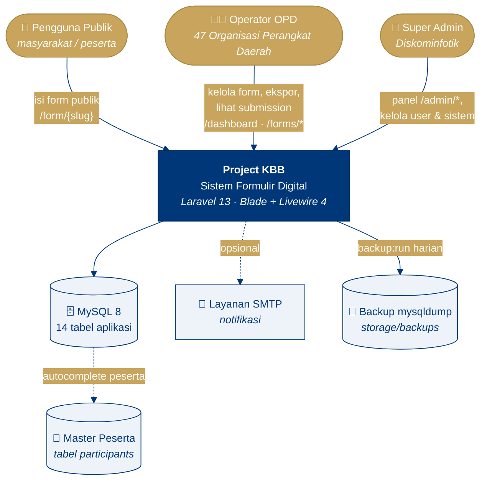

---

## 2. Kontainer / Arsitektur Aplikasi

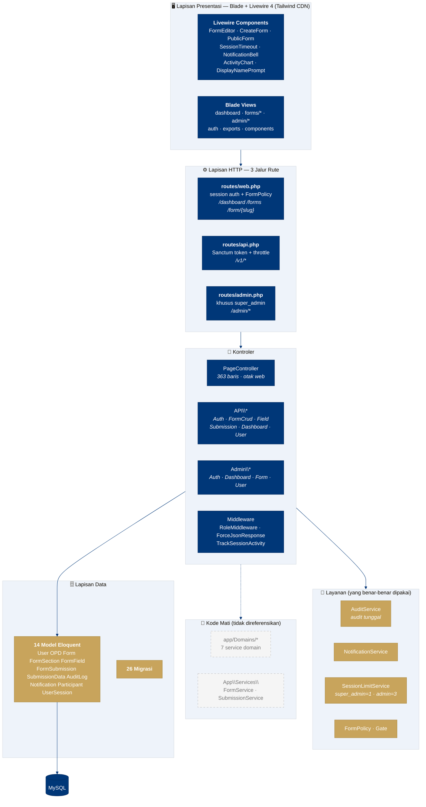

---

## 3. Komponen — Siklus Hidup Request Web

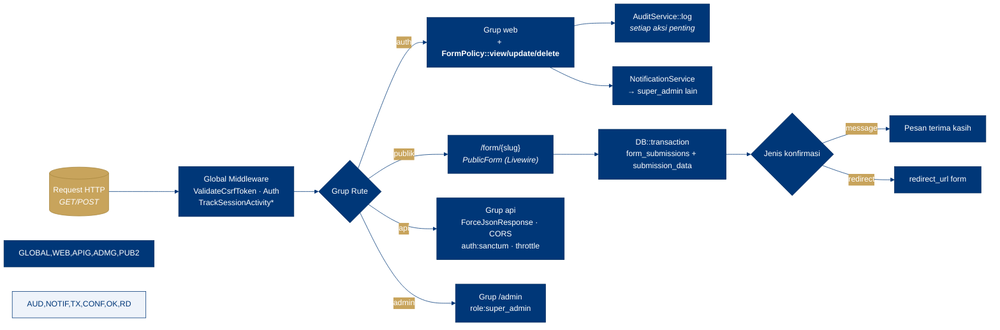

> \* `TrackSessionActivity` kini hanya me-refresh aktivitas pada request **GET** (perbaikan F-19) agar idle-timeout 5 menit berfungsi.

---

## 4. ERD — Basis Data Penuh (14 tabel)

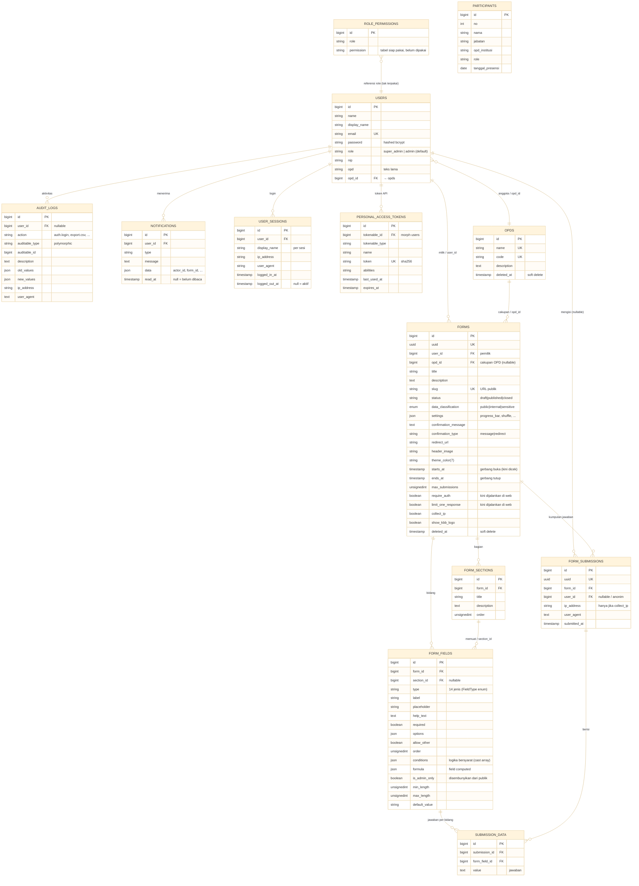

> Tabel infrastruktur Laravel (turunan migrasi bawaan): `sessions`, `cache`, `cache_locks`, `jobs`, `job_batches`, `failed_jobs`, `password_reset_tokens`.

---

## 5. Sequence — Login Web & Pembatasan Sesi

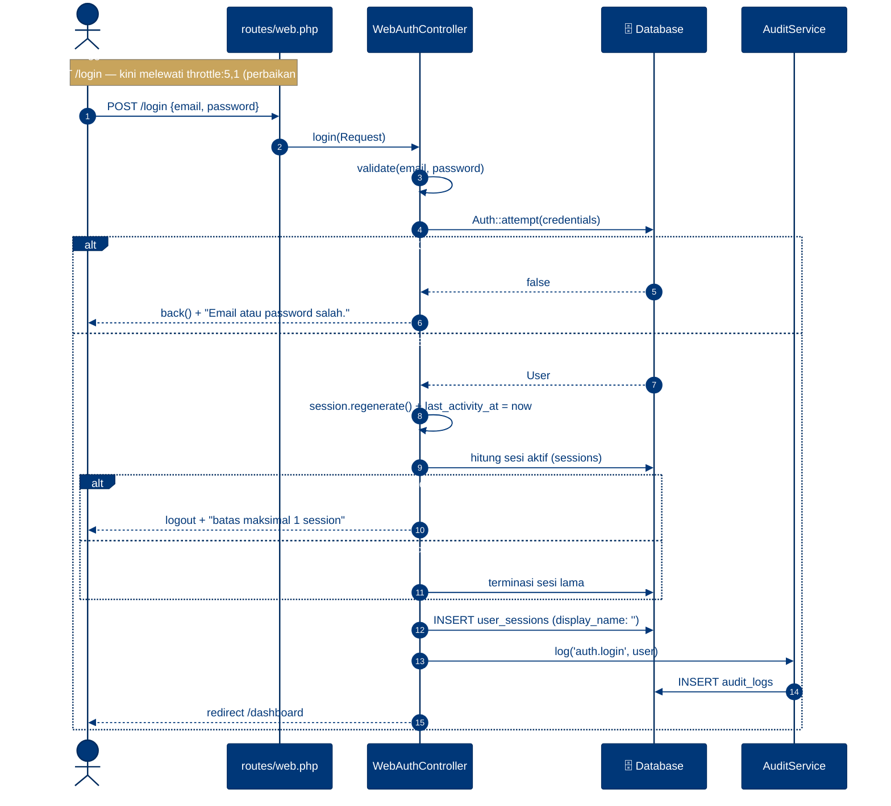

---

## 6. Sequence — Pengiriman Formulir Publik (Livewire)

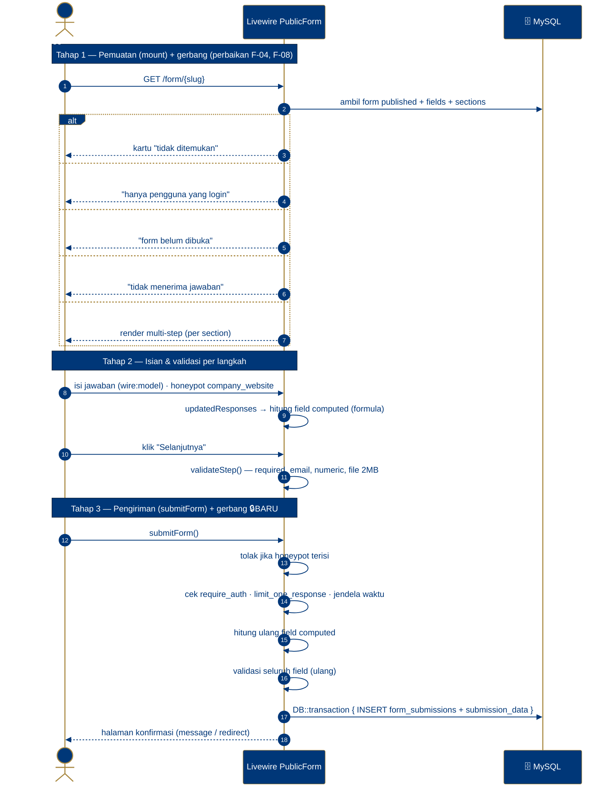

---

## 7. Sequence — Ekspor Data & Gerbang Klasifikasi

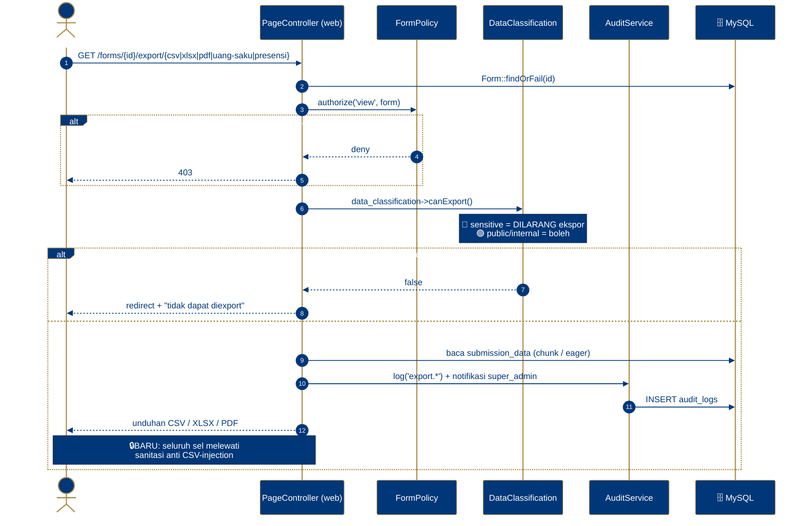

---

## 8. State Machine — Siklus Hidup Formulir

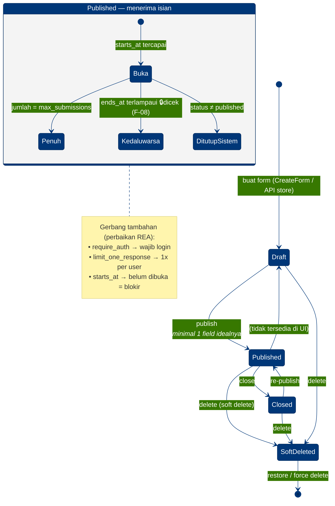

---

## 9. Decision Tree — Otorisasi (aktual)

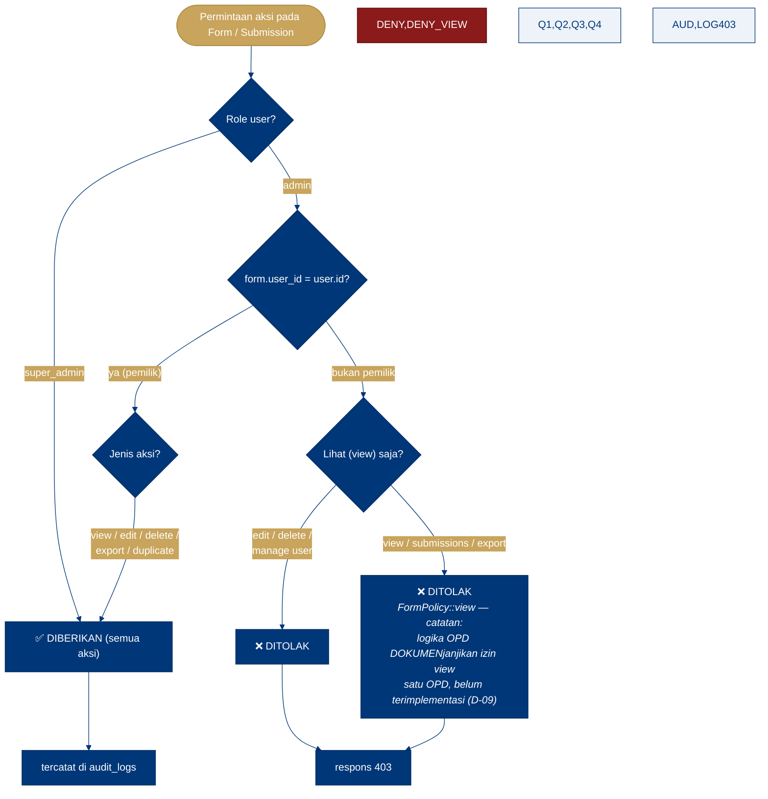

> Perbaikan S-06: penghapusan submission kini menggunakan `authorize('delete', …)` — sebelumnya memakai `view` sehingga admin pemilik form yang sama lintas-OPD sempat bisa menghapus.

---

## 10. Class Diagram — Model Domain

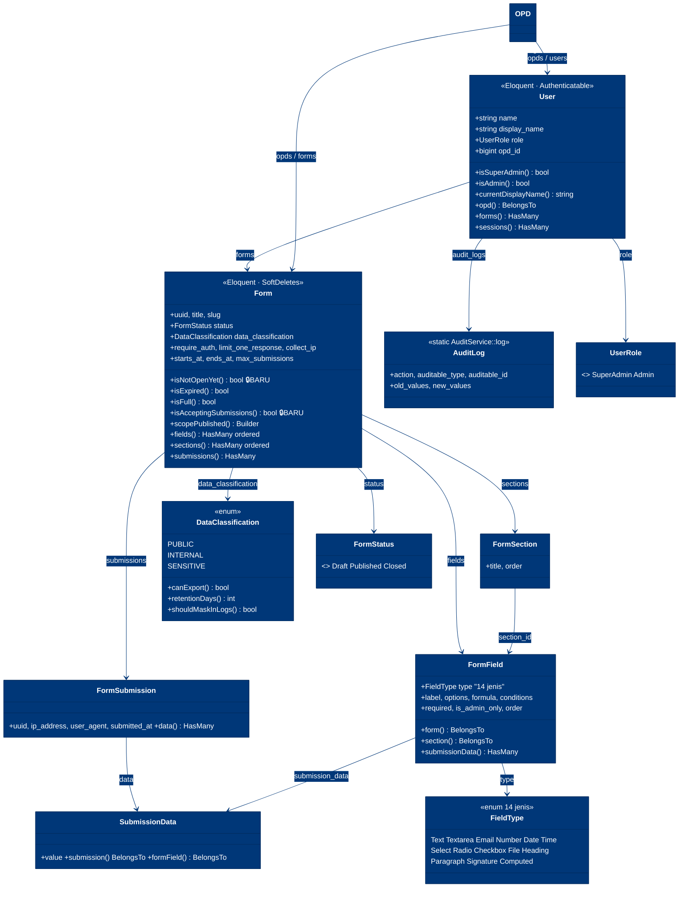

---

## 11. Analisis Temuan (sebaran & prioritas)

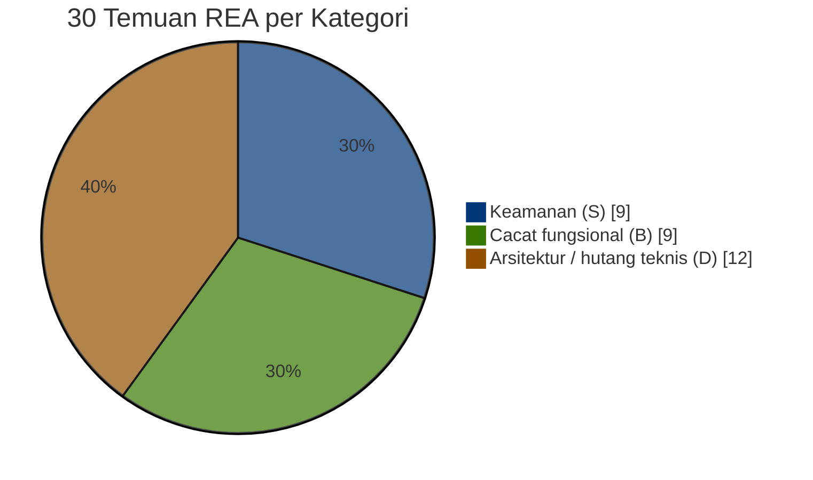

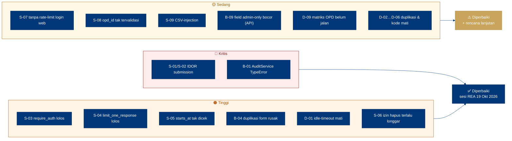

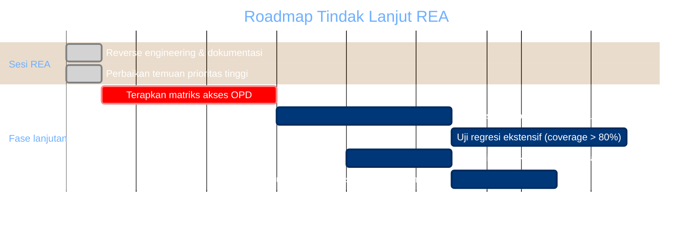

---

*Diagram dibuat untuk dokumen REA Project KBB — 19 Oktober 2026.*
